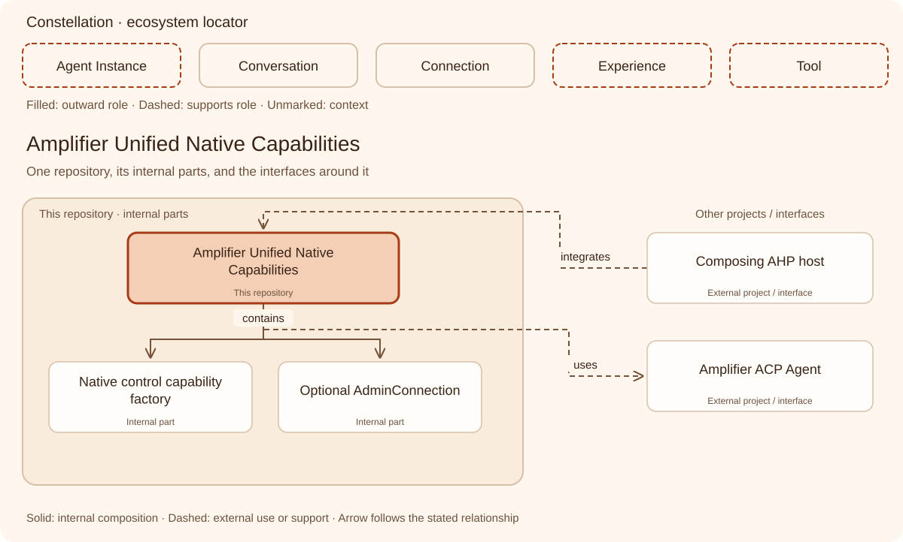

# Unified native capabilities

Add Amplifier configuration and runtime controls to a Unified host: provider
setup, bundle selection, configuration and supported session controls. This
TypeScript integration connects the host to an existing Amplifier ACP endpoint;
it does not implement an agent runtime itself.

## Get started

Use Node.js 22.16+ and an installed
[Amplifier ACP agent](https://github.com/microsoft/amplifier-app-acp).
From a checkout:

```sh
npm ci
npm run build
```

Install the checkout into your host project with
`npm install /absolute/path/to/amplifier-unified-capability-native`.
For basic session controls, supply your host's public callbacks:

```ts
import {createNativeCapabilities} from '@amplifier/unified-native-capabilities';

const capabilities = createNativeCapabilities({
  nativeControl: (uri, operation, args) => host.nativeControl(uri, operation, args),
  onInvalidate: (topic, scope) => host.invalidateCapability(topic, scope),
});
```

This is embedding code: `host` is your initialized host instance. Supply
`capabilities` to its `HostConfig` before listening, and initialize the host before
any callback can run. Available controls depend on the ACP peer's negotiated support.

## Add administration when needed

The exported `AdminConnection` launches the configured ACP command for provider
and bundle administration. The trusted agent configuration must enable
`adminWorkspaceRoots`, and the integration must resolve and authorize each workspace.
Pass `admin.perform` as `nativeAdmin` and close the administration connection when
your distribution shuts down.

See the [administration options](src/admin.ts), [factory options](src/index.ts)
and [bridge contract](contracts/native-bridge.v1.md) before wiring these callbacks.
Client arguments do not grant filesystem or session authority. Requests with an
uncertain result must be inspected through their owner, not automatically repeated.

## Reference

- [Action schemas](src/action-schemas.ts)
- [Provider sign-in integration](src/provider-signin.ts)
- [Permissions](src/permissions.ts) and [message controls](src/messages.ts)
- [Contributor entry](AGENTS.md)


<!-- ecosystem-map:start -->
## Where this fits

An optional host integration for native Amplifier controls, with execution remaining in the ACP agent.

Supports: Agent Instance, Tool, Experience.



[Product page](https://microsoft.github.io/amplifier-constellation/projects/amplifier-unified-capability-native/) · [Open the map](docs/ecosystem-map.svg) · [Map guide](https://github.com/microsoft/amplifier-constellation/blob/main/docs/ecosystem-maps.md)

<details>
<summary>The five shared building blocks</summary>

[](https://microsoft.github.io/amplifier-constellation/)

</details>

<!-- ecosystem-map:end -->

## Contributing

Most contributions require you to agree to a
Contributor License Agreement (CLA) declaring that you have the right to, and actually do, grant us
the rights to use your contribution. For details, visit [Contributor License Agreements](https://cla.opensource.microsoft.com).

When you submit a pull request, a CLA bot will automatically determine whether you need to provide
a CLA and decorate the PR appropriately (e.g., status check, comment). Simply follow the instructions
provided by the bot. You will only need to do this once across all repos using our CLA.

This project has adopted the [Microsoft Open Source Code of Conduct](https://opensource.microsoft.com/codeofconduct/).
For more information see the [Code of Conduct FAQ](https://opensource.microsoft.com/codeofconduct/faq/) or
contact [opencode@microsoft.com](mailto:opencode@microsoft.com) with any additional questions or comments.

## Trademarks

This project may contain trademarks or logos for projects, products, or services. Authorized use of Microsoft
trademarks or logos is subject to and must follow
[Microsoft's Trademark & Brand Guidelines](https://www.microsoft.com/legal/intellectualproperty/trademarks/usage/general).
Use of Microsoft trademarks or logos in modified versions of this project must not cause confusion or imply Microsoft sponsorship.
Any use of third-party trademarks or logos are subject to those third-party's policies.
